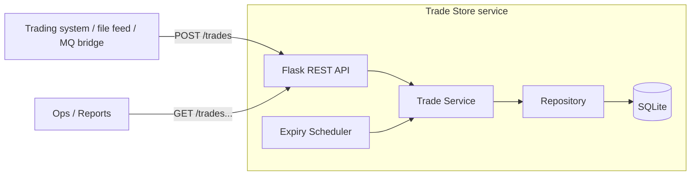
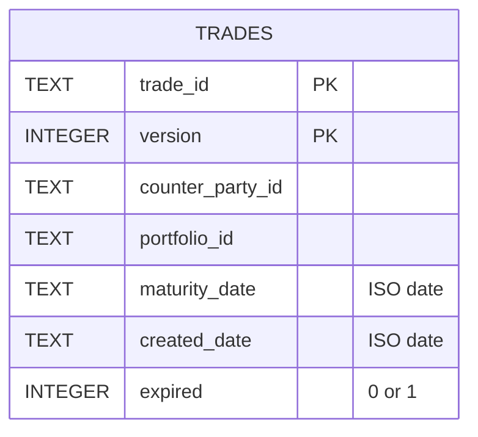
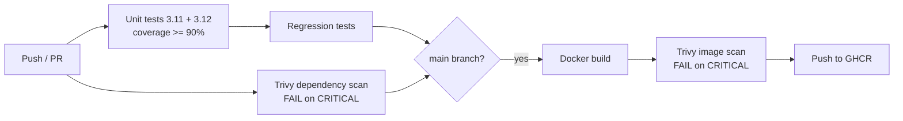
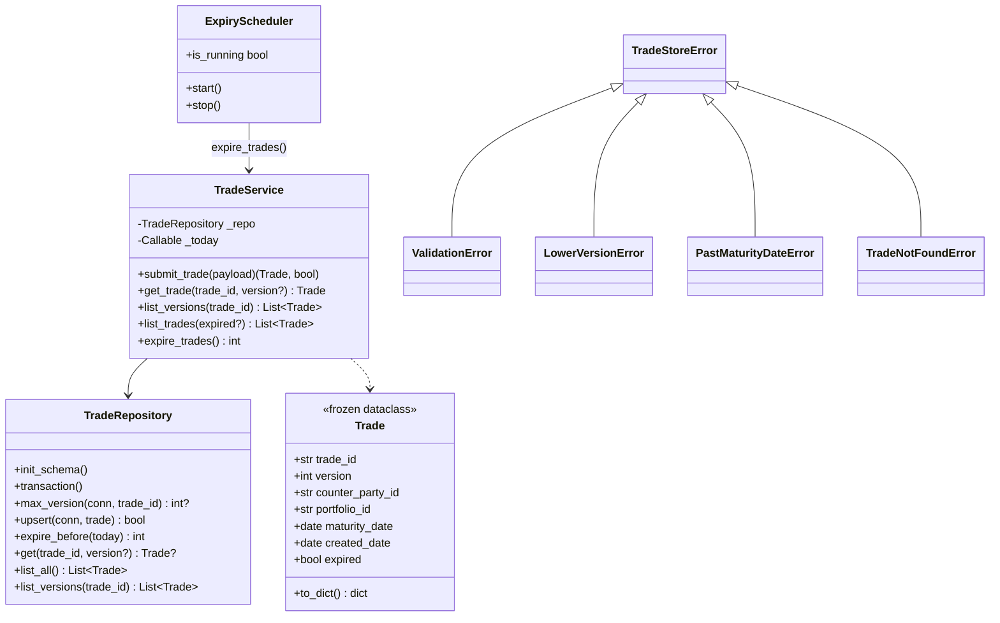
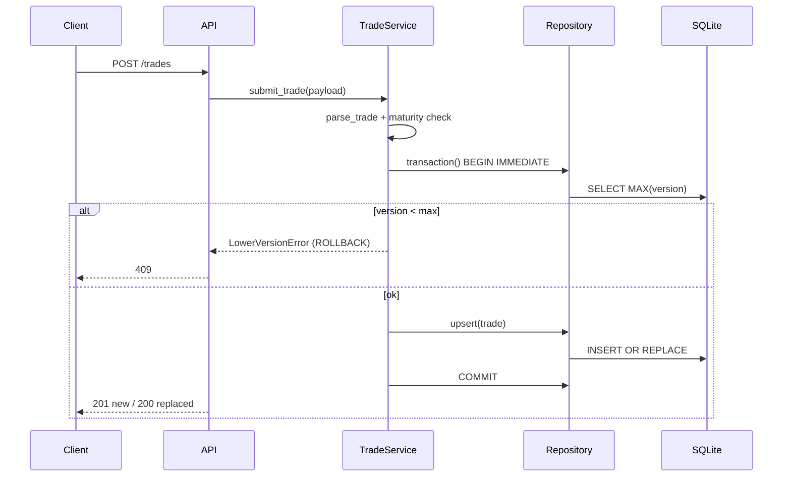
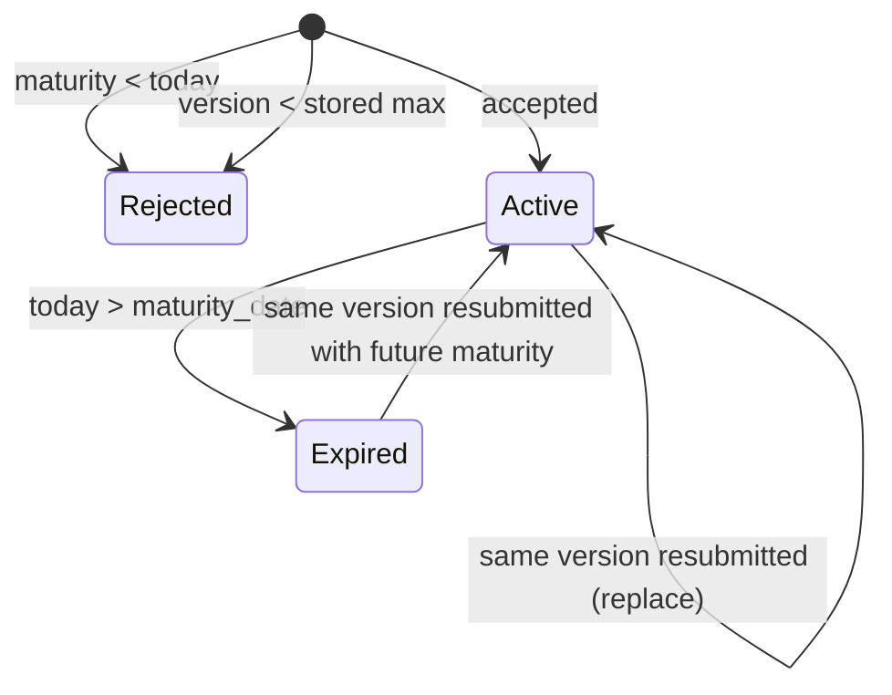

# Trade Store - High-Level and Low-Level Design

## 1. Problem in one paragraph
Trades arrive in large numbers from any channel. The store must keep them in order and enforce three rules:
(1) reject a trade whose version is lower than the stored one, replace on the same version;
(2) reject a trade whose maturity date is before today;
(3) automatically mark a trade expired once its maturity date has passed.

---
# PART A - HIGH-LEVEL DESIGN (HLD)

## A1. Scope and requirements
| Type | Requirement |
|---|---|
| Functional | Submit trade, read latest / specific / all versions, list with expired filter, enforce 3 rules |
| Non-functional | Correct under concurrent writes, deterministic expiry, testable, containerised, automated quality gates |
| Out of scope | AuthN/Z, message-queue ingestion, multi-region |

## A2. System context


## A3. Architecture style
Layered, single deployable service. Each layer has one job and depends only on the layer below:

| Layer | Module | Responsibility |
|---|---|---|
| Transport | `app/api.py` | HTTP routing, JSON in/out, maps exceptions to status codes |
| Application / domain | `app/service.py`, `app/validation.py` | Business rules, orchestration |
| Persistence | `app/repository.py` | SQL, transactions |
| Background | `app/scheduler.py` | Periodic expiry sweep |
| Composition | `app/__init__.py` (`create_app`), `wsgi.py` | Wires dependencies, config |

## A4. Data model
One table; the key is **(trade_id, version)**, which is why T2 v1 and T2 v2 can coexist.


A partial index `(maturity_date) WHERE expired = 0` keeps the expiry sweep cheap as history grows.

## A5. Key flows
**Write path:** client -> API -> validate -> maturity check -> transaction {read max version, compare, upsert} -> 201/200 or error.
**Expiry:** scheduler (every 60 s) and every read call `expire_before(today)` -> one `UPDATE ... WHERE expired=0 AND maturity_date < today`.

## A6. Decisions and trade-offs
| Decision | Why | Trade-off |
|---|---|---|
| Keep every version, key = (id, version) | Matches the sample data; audit trail | More rows; "latest" needs `MAX(version)` |
| SQLite | Zero setup, ACID, fine for the exercise | Single-writer; use PostgreSQL for scale-out |
| `BEGIN IMMEDIATE` around check + write | Prevents a lower version slipping in between check and write, even across gunicorn workers | Writers serialise |
| Scheduler **and** sweep-on-read | Correct results never depend on timer luck | Reads can write (cheap indexed UPDATE) |
| Injected clock (`today_provider`) | Deterministic tests for date rules | One extra constructor argument |
| Server derives `expired` | Client cannot forge state | - |
| Expired the day *after* maturity | Maturity date itself is still valid ("earlier than today" rejects only past dates) | Documented edge case |

## A7. Deployment and CI/CD

Runtime: Docker image, non-root user, gunicorn (2 workers), SQLite file on a mounted volume.

## A8. Scaling path (what I would do next)
1. PostgreSQL (row-level locking, `SELECT ... FOR UPDATE` / advisory lock per trade_id) behind the same repository interface.
2. Put a queue (Kafka/SQS) in front for bursts; consumers call the same service; partition by `trade_id` to keep per-trade ordering.
3. Batch endpoint `POST /trades/batch`; idempotency keys.
4. Move expiry to a single scheduled job (cron/Kubernetes CronJob) instead of one thread per worker.
5. AuthN (API key/JWT), metrics, structured logging, pagination on `GET /trades`.

---
# PART B - LOW-LEVEL DESIGN (LLD)

## B1. Class diagram


## B2. `submit_trade` algorithm
```
today  = clock()
trade  = parse_trade(payload, today)          # ValidationError -> 422
if trade.maturity_date < today:  raise PastMaturityDateError   # 422
BEGIN IMMEDIATE
    latest = SELECT MAX(version) WHERE trade_id = ?
    if latest is not None and trade.version < latest:
        ROLLBACK; raise LowerVersionError                       # 409
    replaced = (row (id, version) exists)
    INSERT OR REPLACE row
COMMIT
return trade, created = not replaced                            # 201 / 200
```
Order matters: cheap, stateless checks (shape, date) run **before** taking the write lock.

## B3. Sequence - submit trade


## B4. Trade lifecycle


## B5. Validation rules (`validation.py`)
- Body must be a JSON object; required: `trade_id, version, counter_party_id, portfolio_id, maturity_date`.
- IDs: non-empty string, trimmed, max 64 chars. `version`: int >= 1 (bool rejected). Dates: `YYYY-MM-DD` or `DD/MM/YYYY`.
- `created_date` optional (default today), not in the future. `expired` from the client is ignored.

## B6. Error contract
| Exception | HTTP | `error` code |
|---|---|---|
| ValidationError | 422 | `validation_error` |
| PastMaturityDateError | 422 | `past_maturity_date` |
| LowerVersionError | 409 | `lower_version` |
| TradeNotFoundError | 404 | `trade_not_found` |
Body shape: `{"error": "<code>", "message": "<human text>"}`. One Flask error handler maps all `TradeStoreError`s, so routes contain no try/except.

## B7. Concurrency
- One short-lived SQLite connection per operation (thread-safe, process-safe).
- Writes use `BEGIN IMMEDIATE` (acquire write lock up front) with a 10 s busy timeout.
- Expiry UPDATE is idempotent, so several workers/threads running it is harmless.

## B8. Test strategy (TDD)
| Level | What | Where |
|---|---|---|
| Unit | validation, repository (real temp SQLite file), service, scheduler | `tests/unit` |
| API | every endpoint and status code via Flask test client | `tests/unit/test_api.py` |
| Regression | problem-statement scenarios end-to-end over HTTP, incl. clock moving past maturity | `tests/regression` |
History is red -> green: failing tests committed first.

---
# PART C - 2-MINUTE WALKTHROUGH (speaking notes)
1. "It's a layered Flask service: API, service, repository, SQLite; plus a small scheduler thread."
2. "Trades are keyed by trade id **and** version, so history is kept; the latest version is the max."
3. "On submit I validate shape, reject past maturity, then inside one `BEGIN IMMEDIATE` transaction compare with the stored max version: lower -> 409, same -> replace, higher -> insert."
4. "Expiry is a single indexed UPDATE, run by a scheduler and also before every read, so answers are right even between runs."
5. "Time is injected, so I can test 'maturity passes tomorrow' without sleeping."
6. "CI runs unit + regression tests, a coverage gate, and a Trivy scan that fails on CRITICAL; on main it builds, scans and pushes the image."
7. "To scale I'd move to PostgreSQL, put a queue in front partitioned by trade id, and make expiry a single cron job."

# PART D - LIKELY QUESTIONS
- **Why not just overwrite by trade id?** The sample data shows multiple versions of one trade; keeping them preserves audit history.
- **How do you stop two requests racing?** Check and write share one `BEGIN IMMEDIATE` transaction.
- **What if the scheduler is down?** Reads run the same sweep, so results stay correct.
- **Why 409 vs 422?** 409 = conflicts with current server state (older version); 422 = request is invalid on its own (bad data, past maturity).
- **Thousands of trades per second?** SQLite is the limit; PostgreSQL + queue + batching (section A8).
